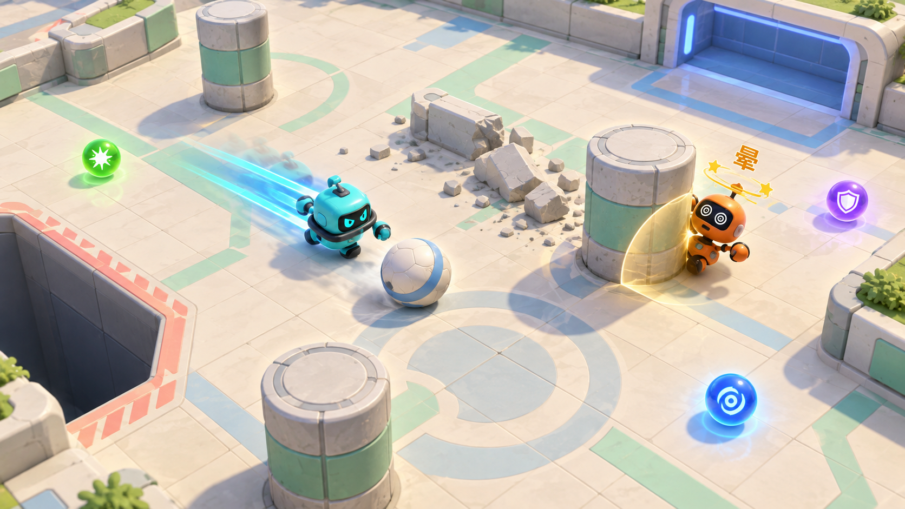

## Context

本次是玩法与表现的联合改版，不是仅换皮。用户已经确认：自由球碰撞射门、18 Tick Dash/结束后 180 Tick 冷却、掉落不计分且 180 Tick 复活、进球重新开球、墙体跨进球保留并在 600 Tick 后等待空位修复、圆柱 36 Tick 眩晕和头顶“晕”、紫色霸体免疫击退/眩晕、大地图跟随视角及本地左右分屏。立体外观以用户明确认可的圆润机器人概念图为基准：

当前代码使用 60 Hz `MatchSim`、可复制的 `MatchSimState`、平面坐标和自有碰撞解算；Unity 网格/粒子/UI 是表现。场地目前 32×48，固定单镜头，Boost 长按持续，篮筐和蓄力仍在模拟、输入、UI、测试与驾驶器里。新增状态不能只存在于 MonoBehaviour、粒子、协程或本机随机数中。

实施基线是当前代码和已经验证的协议 6 生命周期，不是尚未同步的主规范文字。`fix-lan-match-lifecycle` 为 27/27 未归档；`award-pocket-goals-to-opponent` 为 9/10，代码已使用防守球门对手得分而主规范仍写门主人得分。前一个实现的历史证据为 218 个 EditMode、15 个 PlayMode 与 PocketBump0.9 打包测试；这些不构成本改版的测试通过证明。本规划创建时工作树干净，之后只允许本变更目录出现规划改动。

## Goals / Non-Goals

**Goals:**

- 让每次有效身体撞球都能直接产生射门动作，Dash 有清晰风险、反馈和恢复边界。
- 将玩家独立掉落复活与全场进球重开分开，明确墙、Buff、输入边沿等状态的重置范围。
- 新障碍/Buff/随机传送在本地与 LAN 使用同一规则、同一输入带和可回滚状态。
- 大地图采用固定方向的倾斜跟随视角；同机两视口不复制世界、不创建网络连接。
- 正式场景/预制体/材质可在编辑器查看和修改；先验收实际 Unity 小样，再替换正式美术。
- 验证普通输入驱动的合法撞球进球、长时间游戏和多次重赛，不用旧的扣篮刷分驾驶器替代。

**Non-Goals:**

- 不增加跳跃、空中越墙、桥上桥下、PhysX 权威游戏逻辑或另一个独立模拟世界。
- 不增加互联网匹配、自动重连、状态重同步、主机迁移、角色养成、武器或独立射击技能。
- 不擅自采购素材、套用无许可证资源、直接覆盖正式场景、归档旧变更或覆盖已有发布包。
- 不声称生成的概念图已经是模型、动画、实机效果或跨电脑联机验证。

## Decisions

### 1. 已确认规则与候选调优分开

固定规则直接转换为整数 Tick，避免浮点倒计时边界漂移。2026-10-02 用户回复“三个都推荐”，确认 G1 地图/Buff 初值、G2 交互细则及先用临时参数制作可玩灰盒再确认手感；展示灰盒及量化对照后，用户回复“可以就这样”，接受当前地图与手感作为首个生产配置的基线。比赛使用只读、版本化的 `ArenaRulesProfile`；用户确认与代码冻结/测试完成分别记录：

| 类别 | 内容 | 状态 |
| --- | --- | --- |
| Dash | 0.3 秒/18 Tick；按下瞬间方向，无方向取朝向；期间不主动转向；结束或打断后冷却 3 秒/180 Tick；需新按键边沿 | 已确认 |
| 掉落 | 不加分；单人离场 3 秒/180 Tick；其他玩家与球继续 | 已确认 |
| 圆柱 | 0.6 秒/36 Tick 眩晕；禁主动移动/Dash、保留惯性/外力；同接触一次；打断 Dash；紫色免晕不穿实体 | 已确认 |
| 墙体 | 普通接触颤动；高速 Dash 撞碎；600 Tick 后检查占位，空位才恢复；进球不重置墙 | 已确认 |
| 地图 | 48×72；左右掉落开口从 6.45 增至 9.675；保持玩家/球半径 0.78/0.3 和南北门宽 3.4，布局与镜头范围独立 | 2026-10-02 初值及当前灰盒布局已确认 |
| Buff | 绿/紫各 300 Tick；绿给予玩家和球的撞击强化为 1.5 倍；蓝即时安全传送并清零速度；同色刷新不叠强度、绿紫共存；每 600 Tick 生成一个、上限三个 | 2026-10-02 整组初值已确认 |
| 手感 | 当前灰盒的 Dash 速度/距离、普通与 Dash 撞球冲量、互撞额外击退、外力衰减、危险球速度/耗能、碎墙速度阈值 | 2026-10-02 用户“可以就这样”确认首个生产基线；任务 6.5 的独立生产冻结及新增测试已通过，不代表整版已验收 |
| 美术 | 青蓝/橙色圆润机器人，米白/薄荷绿立体场地，浓色 Dash、三色 Buff、晕字与金罩 | 2026-10-02 用户对实际 Unity 小样回复“符合预期”，造型/配色作为正式接入基线；HUD/动态效果/发行版继续验证 |

此次接受的基线是 `greybox-verification.md` 中最终灰盒版本：普通速度 12、Dash 速度 24/无阻挡位移 7.2、球速上限 48、普通/Dash 撞球额外冲量 4/12、玩家互撞额外冲量 6/14、外力速度上限 72、外力衰减 8、碎墙法向速度阈值 18，其他参数和布局保持该版本不变。已另行冻结 `CreateProductionV1` 并通过独立测试，内容哈希为 `7012a8bc484f3d522ace17ccc550c9572659c5d0d2f96fa122a83fa27831abb8`；已有灰盒仍保留 `IsProvisional=true` 和其历史内容哈希 `9de4c55f0cc30454befa6a010afb489c90093605dd692bfe100944ad167d21a2`，不得把旧测试报告改写为新生产配置的验证。此确认不推断用户实际试玩了哪些场景，也不等于承诺最终平衡不再调整。

G2 本文所述交互初案已批准，包括倒计时禁 Dash、碎墙后 Dash 继续、占位复活等待、进球清空 Buff、紫色清晕、蓝色失败消费且不改变原运动、稳定同时事件/随机消费及各阶段计时。后文“初案”保留其设计来由，以本确认记录为当前状态。实际机器人美术样板的 G3 验收门槛仍保留。`greybox-verification.md` 的“待用户批准”文字描述上一次灰盒交付时的历史状态；当前确认状态以本段为准，历史测试与未接入正式联机的限制不变。

### 2. 一套模拟与完整状态，表现不决定规则

保留权威 XY 平面与固定 Tick，不把模拟迁移到 Unity 3D 刚体。3D 显示可继续以 Z 为高度并通过表现映射/镜头姿态得到倾斜俯视；需要标准 XZ 美术坐标的模型在展示层转换。选择这种方式是为了保持已验证的网络架构，而不是将美术方向限制成平面图片。

新增或替换状态至少包括：

- `PlayerSim`：存活/复活计时、控制速度和外力速度、朝向、Dash 锁定方向/剩余 Tick/冷却、眩晕 Tick、有效 Buff 类型/剩余 Tick，以及稳定实体 ID 对应的接触锁存。
- `MarbleSim`：自由球位置/速度/有效标记与必要的撞击接触状态；移除 `Carrier`、持球焊接、篮筐抢夺/充能字段。
- `ObstacleSim`：稳定 ID、完整/破碎/等待修复、剩余修复 Tick；不为未要求的多段生命值系统增加复杂性。
- `BuffPickupSim`：稳定生成 ID、类型、位置、有效状态；全局生成倒计时、下一 ID、随机发生器完整状态。
- `MatchSimState`：新增内容对应数组及规则/布局身份、初始种子、当前随机状态、完整生命周期/回合状态。

所有影响未来结果的字段必须同时进入深复制、恢复、校验和与测试用完整状态比较；不能照搬现有校验和的部分字段列表。实体数组有 profile 验证的容量上限，按稳定 ID 遍历，不依赖对象创建顺序、Dictionary 顺序、Unity InstanceID 或墙钟。

替代方案“每个 Buff/墙用独立 Update/Coroutine、UnityEngine.Random 或本机碰撞回调”被排除，因为回滚无法恢复这些事实。

### 3. 输入边沿、Dash 与碰撞响应分层

输入为移动方向加一次性的 `DashPressed`；原射击槽从 UI 与输入包删除，持久化的原 Boost 键在有效时迁移并保留，新安装或无有效存档时使用 K/小键盘 2。渲染帧锁存短按、每个模拟 Tick 只采样一次；预测远端时清除 Dash 边沿。死亡/眩晕/冷却期间的非法按键不排队，不在恢复后自动触发；长按没有下一次边沿。

Dash 的 N/N+18/N+198 边界用测试定义完整时长，而不是在启动同 Tick 无意减掉一次。Dash 锁的是玩家主动驱动方向，不提供无敌；碰撞外力、死亡和眩晕仍可发生。柱眩晕中断时马上进入完整冷却，合法碎墙不必结束尚未用完的 Dash。是否允许开球倒计时 Dash 的初案为“倒计时只普通移动，Live 才可 Dash”，须在规则确认门槛中明示，不能只靠 UI 隐藏。

保留基础圆碰撞的单位法线、质量加权解穿透、仅闭合速度反弹及退化点保护。新“射门/更强互撞”作为额外玩法冲量，按闭合相对速度和 profile 计算，并用接触事件锁存保证一个接触只增加一次，不能在 6 次解算迭代或持续贴住期间累加能量。普通和 Dash 撞球无需另按射击键，球保持自由。将外力从主动速度控制中分离，避免玩家持续按方向时下一 Tick 就被正常移速上限吞掉击退。

紫色霸体抑制动态物体给予玩家的速度冲量/眩晕，仍执行非穿透约束和静态边界约束；基础解算器的普通数学合同不改写成“所有碰撞不守恒”。绿只增强给予对方/球的玩法冲量，不凭空加移动速度。更快的运动通过固定次序的扫掠/有界子步处理静态障碍、动态圆与进球/掉落穿越，不以客户端帧率决定子步数；不得为了效果保留高速穿墙或穿球漏洞。

### 4. 事件顺序、复活与分层重置

每个模拟 Tick 使用明确、双方一致的阶段顺序：输入/计时边界 → 合法移动与 Dash → 连续碰撞查询及基础约束 → 接触产生的冲量、柱眩晕/破墙 → 掉落记录和自由球进球候选 → 决议最多一个进球 → 若无进球则处理活着玩家的 Buff 拾取/安全传送 → 到期复活与墙修复的占位检查 → 快照/事件。具体函数划分可调整，但语义和同 Tick 顺序必须有测试。接触先按扫掠命中时刻排序，同刻按类型（圆柱先于可碎墙）与稳定实体 ID 排序；同 Tick 撞柱导致 Dash 已中断后，不可再以过期的 Dash 状态破墙。接触判定和事件集合不能取决于多轮求解器的偶然遍历顺序。

技术初案：同 Tick 多个球进门先北后南，再按球 ID；掉落不是计分候选，不抢走合法进球。双方同时掉落时比分不变、各自复活；死亡中的玩家无碰撞、不能拾取或推球。安全复活从己方预定义有序候选点选择，排除实体、自由球、对手与死亡区；位置都被占用则保持等待并逐 Tick 重试，不强推或重叠生成。180 Tick 是最早可复活时刻，正常空位必须准时；这一防夹方案同样列入规则确认，不暗加出生无敌或出生攻击。

| 状态 | 玩家掉落/独立复活 | 合法进球重新开球 | LAN 双方同意的新比赛 |
| --- | --- | --- | --- |
| 比分、对手和球 | 不改变 | 失球方对手加 1 分，双方与球重置 | 分数归零、完整新比赛 |
| 玩家 Dash/晕/速度/Buff | 掉落清除活动状态；冷却不因自杀提前变好，离场期间随模拟计时；复活速度归零 | 双方清理瞬态并复位，死亡计时取消 | 全新状态和边沿 |
| 墙体与修复时间 | 保留 | 保留，冻结展示/开球倒计时仍推进其剩余时间 | 全部完整，计时清零 |
| 地上 Buff/生成计时 | 保留世界状态，掉落者不能拾取 | 初案清空地上道具和玩家 Buff，重新安排生成；随机流不回退 | 按新 epoch 初始种子/规则初始化 |
| 相机、一次性表现 | 独立掉落提示，相机不跟坠落高度 | 复位镜头与个人 HUD，保留墙展示 | 清空旧 epoch 提示、FX、计数与缓存 |

仅 `Kickoff`、`Live`、进球展示冻结仍推进环境 Tick；终局和网络故障冻结不推进 Dash/Buff/墙修复等游戏计时，结算保活仍按真实时间运行。保持三秒开球、双方半场门和净胜两分；进球后死亡玩家随统一重置恢复。Buff 重置策略、倒计时 Dash 策略、拥挤复活 fallback、同 Tick 决议作为技术初案交由首个规则确认任务整体核对。

### 5. 圆柱、墙与安全修复

静态布局使用稳定 ID 的圆柱圆形边界与墙段 AABB，渲染/模拟从同一布局读取；装饰不创建额外权威碰撞。柱接触在真正新接触时记录，即使玩家有紫色霸体也记录接触锁存，避免紫色到期仍贴着柱子时突然眩晕。眩晕不冻结整个比赛，不影响另一玩家输入。

只有处于有效 Dash 且撞击法向速度达到 profile 阈值的玩家能破墙。普通玩家或球撞墙只反弹/颤动，绿色强化本身不代替 Dash 条件。破墙在模拟中先撤除该墙实体约束，再产生一次展示事件；碎片无游戏伤害、无权威碰撞。

从破碎时刻起计 600 Tick；到期后检查整个墙实体体积与有效玩家/全部自由球的间隔，仍占位则 `RepairPending`，每 Tick 重试。恢复前预览轮廓不能用于碰撞；清空后只恢复一次，不夹人、不传送球、不反复播放特效。进球归位位置也参与当 Tick 最终占位检查。

### 6. Buff 与可回滚随机性

Buff 是独立于得分球的实体类型，不进入球门计分和球数量设置。三色有形状/图标双重辨识。仅 Live 生成和拾取；生成槽位、权重、上限、周期、效果时长与倍率来自已批准 profile。初案绿紫并存、同色刷新时间而不叠强度；绿影响给玩家/球的额外冲量，紫免击退和眩晕，不提供掉落豁免。取得紫色时清除当前眩晕，但不重置 Dash 冷却；需要纳入首个规则确认。

随机数采用明确算法和完整状态（初案为非零 32 位 xorshift 状态，运算位宽与溢出规则写死），主机在初次连接和重赛准备时提供双方一致的种子；种子是玩法状态，不用随机连接 ID 隐式替代。产生点按有序、有限候选集挑选并排除出生安全区、危险区、静态障碍及活跃实体。没有生成位置时延后，不无限重抽；空候选不消耗随机数、不分配拾取 ID，候选非空才按约定次数采样类型和位置。生成每 Tick 的次数有上限，不补发一帧掉帧期间的多次物品。

拾取处理按拾取物稳定 ID 递增；同一个物品被两人同时覆盖时，先比较碰撞后玩家中心与物品中心的距离平方，完全相等时以座位 ID 决胜。每次消费后再判断下一物品，蓝色只检查落点上的安全性，不在一个 Tick 递归收取传送终点的第二个道具。持续 Buff 在有模拟 Tick 的阶段递减；生成倒计时只在 Live 递减，进球重开重新计时，MatchOver/网络暂停完全冻结。以上均作为可测试的技术初案纳入 G2。

蓝色拾取立即触发一次有界安全选择：排除死亡/门洞、完整或待修复墙、柱、对手与自由球，保证目标在当前可通行区域；成功后速度清零、活动 Dash 终止进入冷却，重设旧位置接触记录与镜头插值，其他有效 Buff 不清除。每次蓝色消费固定推进随机发生器一次，以结果选择候选起始索引后循环最多一遍；候选为空或全不安全也推进同样一次。没有安全位置时保留原位置、速度和既有 Dash/冷却状态并报告“无安全落点”，仅本次道具和结果事件被消费，不执行一半传送、不强行进墙或无限循环。这是待规则门槛确认的失败初案。

拾取说明为个人视口短提示，仅读事件；没有点击确认、不暂停、不抢焦点。持续图标与剩余时间仅读模拟。回滚导致不存在的拾取不能留下效果或重复弹窗。

### 7. 网络兼容与已完成生命周期的继承

计划采用协议 7、显式的新输入编码/校验；实施前检查当前最大兼容版本，不能复用已经发布给另一套规则的编号。`ArenaRulesProfile`、布局内容（边界、门/洞/柱/墙/生成点）、动态容量与模拟规则修订使用稳定规范化序列形成内容身份；不使用本机路径、资产 GUID 的偶然顺序、运行时字符串 GetHashCode 或随机素材 ID 代替规则身份。握手比较身份并协商初始种子，Finish 和 Rematch 绑定相同身份，重赛不能偷偷更换地图规则。

双向拒绝协议 4/5/6 等旧射击/Boost 客户端，保留 legacy-length 探测、nonce、endpoint/seat/MatchId/epoch 校验；扩大消息时更新长度/上界/错误路径测试。更换输入后同时更新 Pack/Unpack/Equals/保留位检查/历史重发/只采样一次/远端预测。

明确继承 v6：接收队列在每个固定模拟步进之前和期限检查之前排空；输入补洞、连续 Ack、终局 Reconcile 和匹配 Finish/FinishAck；有效心跳不会掩盖缺输入；初连与重赛安全启动屏障；双边同意、同 socket 同座位同规则、递增 epoch；5 秒缺输入/静默与独立 15 秒协议进度期限；真实错误冻结 Arena 并显示原因，由用户手动回主菜单。不借本变更加入重连/重同步。

### 7.1 比赛内有界输入节拍协调（2026-10-03 已确认）

`PocketBump0.10` 长测中快端准备执行 455，而慢端仅生成至 442，连续确认同为 442；把尚未产生的 443 误判为退出 12 Tick 窗口的输入洞。用户明确批准：快端等待、有效新输入恢复、5 秒无输入进展后保持暂停，不扩大回滚窗口。

在会话步进层、输入采样之前检查领先量，预留恢复空间；当连续远端输入前缀等于最新远端输入且达到安全上限时，停止生成新模拟 Tick。等待不是终局失败，也不改全局 `Time.timeScale`，游戏内计时随模拟停止；继续接收、确认和重发原输入历史、生命周期心跳与期限检查。恢复前不消费 Dash 边沿，恢复后每个 Tick 仍只采样一次。

安全领先阈值须同时保护状态校验的可接收窗口，而不仅是输入本身。0.11 实测发现只取 12 会让较慢端的校验值持续过旧：慢端当前 Tick=P、最新已生成输入 P+1、最新已执行状态 P-1，而快端可达 P+13。修正为 `MaximumInputLeadTicks = BufferTicks - DelayTicks = 10`，快端最多 P+11，原 12 Tick 校验接收下界恰为 P-1；不扩大回滚或校验接收窗口、不更改 wire/游戏规则。回归必须证明持续非对称节拍期间双方校验计数持续增长，不能只在最后追平时比较状态。

若最新远端输入已经越过连续前缀，则存在真正的中间缺口，不能由节拍等待掩盖；原回滚边界检查和 `INPUT HOLE` 保留。暂时等待须有独立的 5 秒真实时间输入进展期限，只有正确端点/连接/epoch 的有效输入前缀前进才刷新，心跳、重复、旧 epoch 和无效包不能延长。边界处先排空队列再判期限；超时显示 `INPUT PROGRESS TIMEOUT` 并保持故障暂停直至手动返回菜单。完全静默仍可先触发现有 `PEER TIMEOUT`。新 epoch/新连接清空等待状态，诊断保留可区分的累计证据。

右上面板区分可自动恢复的“等待对方输入”和不可自动恢复的网络失败；保持原有真实错误处理。验证需覆盖非对称步进、短时停步、恢复边沿、仅心跳无进展、真实中间洞、重赛清理与多分辨率 UI。新增独立、明确标记的真实双进程停步注入，不改已有故障语义，也不能仅凭请求等待或注入计数宣称恢复成功。

### 8. 相机、分屏和视口 HUD

一个 `MatchDirector`、一个模拟世界、一个场景。Local 为左右两个 `Camera.rect` 各 50%，各随所属玩家；LAN 为已分配本机座位的一台全屏相机。倾斜但固定同向，屏幕上方仍对应场地北方；不让玩家二获得反转的操作坐标。相机读插值后的表现位置，有边界限制与可调观看范围，而不是按地图大小缩小到全场。

一个 AudioListener/全局比赛 UI 层，两个独立个人 HUD 容器；个人 Dash、Buff、晕、复活倒计时和拾取提示不能越过分割线。比分、终局导航与网络故障仍为明确的全局层。窗口尺寸/全屏切换触发相机投影与 UI 安全区重新布局；至少检查 1280×720、1920×1080 与 4:3。

掉落镜头跟随角色的平面位置或停留在最后安全位置，不追随下落特效的高度；复活/传送重置插值与拖尾，避免全地图一道错误长线。通过低矮障碍/视图侧淡化处理角色遮挡，不删除真实碰撞。球和球门的屏幕边缘指示列为推荐可读性处理，不新增小地图或另一个复杂导航系统。

### 9. 美术资源、授权和编辑器交付门槛

概念图在本变更 `references/approved-art-concept.png` 中留存，仅作为风格参考。实施先盘点已有 Kenney 源包及授权，列出新模型/材质/贴图/声音的来源、许可证、成本和修改需求，向用户展示实际候选；未获确认不下载引入新的外部资源，不擅自购买。新增资产要记录来源和再分发条件，原始源文件与项目加工资源分开。

先创建独立 Unity 美术样板及视觉 Prefab：两机器人、地面、自由球、三色 Buff、柱和可碎墙，实际运行展示 Dash、碰撞、晕、碎裂/修复。截图/录屏必须来自实际 Unity 视图，不能拿概念图当完成证据。用户批准实际样板后才改正式 `Arena`/`MainMenu` 场景；灰盒阶段和新功能测试可独立进行，不等于批准正式美术覆盖。

角色模型的可见脚印与碰撞半径对齐；挤压/回弹只作用视觉子对象。统一主题使用可编辑材质/配置引用，不让 `ArtCatalog.AttachModel` 无条件替换所有材质或按三个轴分别拉伸模型。导入比例采用可审阅的保持比例适配；阴影/灯光依样板性能决定。场景烘焙改为明确目标、增量幂等更新，保留用户手摆子层级；不让 Awake/全量重建在运行、重载或保存时覆盖人工外观。动态高亮只叠加临时效果，不永久重写基材质。

碎片、粒子、残影对象有池和同时显示上限；持续状态随当前修正状态更新，一次性碎裂/拾取/声音按连接/epoch/Tick/实体/事件类别去重并在回滚撤回时消除不真实反馈。中文字体必须包含“晕”和 Buff 说明，两个视口都正确面向相机。是否新增音效包属于资源确认，不因提出“金钟罩”就自动引入付费声音。

### 10. 验证与证据分级

先留当前 EditMode/PlayMode/socket/打包基线，再新增红测。新测试覆盖完整状态比较，而不只检查部分哈希；参数化测试可用标明的测试 profile。保持基础碰撞的已有数学断言，删除旧功能测试须给出新行为对应测试，不能只把失效断言注释掉。

新自然驾驶器从普通零分开球开始，实际以玩家身体/Dash 撞自由球进入真实球门取得合法胜利；不能设置比分、强制 MatchOver、调用旧 Fire/Collect 或用掉落得分。复杂 Buff/墙/复活里程碑可以分成独立可重现机制场景，但测试来源必须标明 `normal_gameplay` 或具体 fixture，不能把独立夹具的成功拼成自然完整局的证据。

完整打包验收包含默认 smoke、握手丢包、自然完整局与重赛、三次连续重赛及双方分别离开后重新加入、相关新机制场景和终局/重赛故障注入。每例要求双端最终报告、相同规则/布局身份和终局元组、已确认真实事件、实际故障注入计数及 launcher 结果。负例的 PASS 只代表得到声明的错误，不能冒称游戏继续。保留旧日数据原样，不用新字段重写历史报告。

实际 Unity 小样验收、模拟/场景单测、真实双 socket、本机打包双进程、双电脑 LAN 分别记录；没有两台电脑访问权限时给出人工清单并写明未执行，不能用 loopback 成功替代。

## Risks / Trade-offs

- [Risk] 新速度和窄障碍引发隧穿，或下一 Tick 控制速度抹掉击退。→ 独立外力通道、有界连续碰撞处理、普通/Dash/绿三组量化轨迹与双方座位回放对照。
- [Risk] 回合重置误删墙状态/重复复活，或在终局继续环境 Tick 破坏 Finish。→ 显式重置矩阵、同时事件测试、终局协调仍不产生新模拟 Tick。
- [Risk] PRNG、生成顺序、接触锁存或新数组漏复制导致 DESYNC。→ 完整状态 schema 清单、单字段变异校验测试、延迟/乱序输入的完整快照相等验证。
- [Risk] 旧主规范/旧变更后归档覆盖新版语义。→ 下述迁移顺序记录冲突，旧变更不在本次规划中自动同步；新 delta 与有效基线逐条对照。
- [Risk] 用户批准概念图却收到不匹配的现成机器人或运行时换色。→ 候选资源与真实小样两道确认，正式编辑器可见性和持久化编辑测试。
- [Trade-off] 双相机和丰富粒子提高渲染成本。→ 比较同等窗口尺寸单屏/分屏帧时间、可见对象和粒子上限；报告实测硬件和场景，不凭空许诺通用 60 FPS。
- [Risk] 尚未确认的初值固化为规则。→ tasks 首段先确认 profile/灰盒；参数暂不获答复时停止依赖步骤，而不是替用户决定。

## Migration Plan

1. 保留现有源代码、正式场景、主规范、旧变更和所有发布目录，记录开始实施时的实际工作树与协议/构建基线。
2. 对齐有效基线：`fix-lan-match-lifecycle` 的完整已实现要求必须保留；其中旧诊断要求 `Full-match diagnostics prove actual gameplay completion` 必须由本变更移除并用碰撞进球证明替代，不能继续要求已删除的 collect/shoot。`award-pocket-goals-to-opponent` 的对手得分需求被本变更延续，但“掉落加分/优先级”被明确替换。`catch-on-basket-contact` 与将删除的篮筐功能冲突，保留历史并在实施前登记不再作为新版功能来源。先前变更若需同步/归档要另得用户授权；同步次序是旧基线在前、本新版在后，不能日后把旧快照整块覆盖新版。若旧变更尚未同步，未来同步本变更前先解决对应 ADDED/REMOVED 前置要求，不擅自略过缺失基线或把本变更标成已归档。
3. 确认参数/技术交互初案，建立 profile、布局与完整状态、输入边沿和协议版本，再做核心玩法灰盒。
4. 添加 Buff、障碍与安全生成/修复，逐层执行回滚和真实 socket 测试；保持旧失败暂停与重赛合同。
5. 新增相机/视口和独立美术样板；资源确认与实际样板批准后才落入正式场景，保留可回退的旧资源和布局。
6. 完成全量自动化、双方打包诊断、编辑器/运行/窗口切换视觉复核，输出验证记录和两电脑 LAN 清单。
7. 构建到下一个尚不存在的 `D:\uniry Assets\射球大战\PocketBump<major>.<minor>` 文件夹。当前可见最高为 `0.9`，若期间没有新包，下一个是 `0.10`；按整数版本分段递增，不把 `0.10` 当成数值 `0.1`。构建前重查，不覆盖旧包或失败候选。双方分发完整同版文件夹。
8. 回退采用旧完整构建/保留的旧资源，不执行破坏性 git reset、删除工作目录或让不兼容版本混连。本次计划不自动归档任何 change。

## Open Questions

- **G1 初值和灰盒手感已确认 / 生产冻结已验证**：2026-10-02 用户在收到具体 profile、轨迹对照与灰盒入口后回复“可以就这样”，接受当前地图、Dash、击退及碎墙阈值。任务 6.5 已落实独立生产配置，新增 profile 测试已通过，证据见 `greybox-verification.md`；不修改历史灰盒证据，不把本确认扩大为 G3 美术或完整 LAN/发布验收。
- **G2 已确认**：2026-10-02 接受本文交互细则；实施若发现新的玩法歧义仍须询问，不将本次答复扩展成任意规则授权。
- **G3 实际样板已确认**：用户已批准原创可编辑圆润机器人、沿用现有 CC0 资源、首版静音的独立制作路线，并单独批准下载 Noto Sans CJK SC Regular（见 `resource-candidates.md`）。2026-10-02 在收到 `20261002-reviewed-sample` 的实际 Unity 展示台及双视口画面后回复“符合预期”，允许以该造型/配色样板推进正式场景接入；不是仅凭概念图放行。HUD 排版、动态特效与正式单屏/分屏及发布性能仍按 8.4/12.3 单独实测，未展示或未验证部分不能因此标为通过。
- **G4 外部验证安排已确认**：2026-10-02 用户同意由其和朋友在最后使用同一完整新版本执行双电脑 LAN 验收，并提供两端报告供检查。先完成本机自动化和新包，再交付操作清单；当前双电脑测试仍为未执行，不得据此承诺真实 Wi-Fi 无问题。
